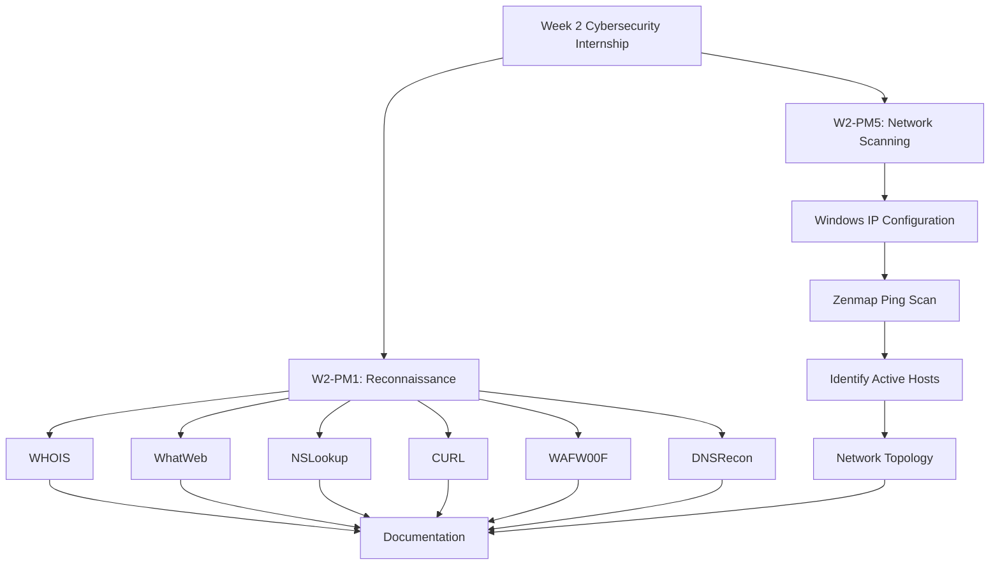

# 🔍 NETWORKWALKS – WEEK 2: FOOTPRINTING & NETWORK SCANNING

<p align="center">
  
  
  
</p>

<p align="center">
  <b>Cybersecurity & Ethical Hacking Internship</b><br>
  Practical Report – Footprinting, Reconnaissance and Network Scanning
</p>

---

## 📌 REPORT DETAILS

| Field | Details |
|---|---|
| **Intern Name** | Adithya Nair |
| **Organization** | Networkwalks |
| **Internship Domain** | Cybersecurity & Ethical Hacking |
| **Internship Week** | Week 2 |
| **Practical Modules** | W2-PM1 and W2-PM5 |
| **Project Title** | Footprinting & Network Scanning |
| **Date** | 13 November 2026 |
| **Host Operating System** | Windows 11 |
| **Virtualization Platform** | Oracle VirtualBox |
| **Linux Environment** | Kali Linux |

---

## 📑 TABLE OF CONTENTS

1. [Disclaimer](#-disclaimer)
2. [Introduction](#-introduction)
3. [Project Overview](#-project-overview)
4. [Objectives](#-objectives)
5. [Lab Architecture](#-lab-architecture)
6. [Lab Configuration](#-lab-configuration)
7. [Tools Used](#-tools-used)
8. [Activities Performed](#-activities-performed)
   - [W2-PM1: Footprinting & Reconnaissance](#1-w2-pm1--footprinting--reconnaissance)
   - [W2-PM5: Network Scanning with Zenmap](#2-w2-pm5--network-scanning-with-zenmap)
9. [Risk Analysis](#-risk-analysis)
10. [Recommendations](#-recommendations)
11. [Problems Faced](#-problems-faced)
12. [Learning Outcomes](#-learning-outcomes)
13. [Evidence Collected](#-evidence-collected)
14. [Repository Structure](#-repository-structure)
15. [Conclusion](#-conclusion)
16. [Author](#-author)

---

# ⚠️ DISCLAIMER

This repository is created for educational and internship purposes as part of the Networkwalks Cybersecurity & Ethical Hacking program.

The practical exercises demonstrate basic information gathering, reconnaissance and network scanning techniques.

All activities should be performed only on systems, domains and networks for which appropriate authorization has been obtained.

The information documented here represents observations from the tools used during the practical exercises. It should not be considered a complete security audit or confirmation of vulnerabilities.

---

# 📖 INTRODUCTION

Footprinting, reconnaissance and network scanning are important initial stages of cybersecurity assessment.

During Week 2 of my internship at Networkwalks, I worked on two practical modules:

- **W2-PM1:** Footprinting & Reconnaissance
- **W2-PM5:** Network Scanning with Zenmap

In the first practical, I used Kali Linux tools to collect publicly available information about the target domain `networkwalks.com`. I examined domain registration information, DNS records, website technologies, HTTP response headers and Web Application Firewall detection results.

In the second practical, I used Zenmap on Windows 11 to scan my local network, discover active devices and understand basic network topology.

These exercises helped me understand how information gathering and network discovery are used in cybersecurity.

---

# 📂 PROJECT OVERVIEW

| Module | Practical Name | Main Activity |
|---|---|---|
| W2-PM1 | Footprinting & Reconnaissance | Collecting domain and website information |
| W2-PM5 | Network Scanning with Zenmap | Discovering active devices on a local network |

### Project Workflow



---

# 🎯 OBJECTIVES

The main objectives of this project were:

1. Understand the fundamentals of footprinting and reconnaissance.
2. Learn how to collect domain registration information using WHOIS.
3. Identify website technologies using WhatWeb.
4. Understand DNS resolution using NSLookup.
5. Inspect HTTP response headers using CURL.
6. Identify Web Application Firewall technologies using WAFW00F.
7. Perform DNS enumeration using DNSRecon.
8. Understand IP addresses, subnet masks and default gateways.
9. Perform network discovery using Zenmap.
10. Identify active devices on a local network.
11. Generate and understand a basic network topology.
12. Document practical observations and findings.

---

# 🖥️ LAB ARCHITECTURE

The practical work was performed using Kali Linux and Windows 11.

### Architecture Diagram

```text
                    CYBERSECURITY LAB
                           |
             +-------------+-------------+
             |                           |
          KALI LINUX                  WINDOWS 11
             |                           |
      FOOTPRINTING &                 NETWORK SCANNING
      RECONNAISSANCE                       |
             |                          ZENMAP
       +-----+------+                      |
       |     |      |                 NMAP PING SCAN
     WHOIS WhatWeb DNS                      |
       |     |      |                 ACTIVE HOSTS
      CURL WAFW00F DNSRecon                  |
             |                       NETWORK TOPOLOGY
             |                           |
             +-------------+-------------+
                           |
                    FINAL DOCUMENTATION
```

---

# ⚙️ LAB CONFIGURATION

### System Configuration

| Component | Configuration |
|---|---|
| Host Operating System | Windows 11 |
| Virtual Machine Software | Oracle VirtualBox |
| Guest Operating System | Kali Linux |
| Reconnaissance Environment | Kali Linux Terminal |
| Network Scanning Software | Zenmap |
| Nmap Version | 7.993 |
| Network Interface | Wi-Fi 2 |

### Local Network Configuration

| Parameter | Value |
|---|---|
| IPv4 Address | `192.168.31.213` |
| Subnet Mask | `255.255.255.0` |
| Default Gateway | `192.168.31.1` |
| Network Range | `192.168.31.0/24` |
| Scan Type | Ping Scan |
| Total IP Addresses Scanned | 256 |
| Active Hosts Found | 5 |

---

# 🛠️ TOOLS USED

The following tools were used during the practical exercises.

| No. | Tool | Platform | Purpose |
|---|---|---|---|
| 1 | WHOIS | Kali Linux | Retrieve domain registration information |
| 2 | WhatWeb | Kali Linux | Identify website technologies |
| 3 | NSLookup | Kali Linux | Perform DNS queries |
| 4 | CURL | Kali Linux | Inspect HTTP response headers |
| 5 | WAFW00F | Kali Linux | Identify Web Application Firewalls |
| 6 | DNSRecon | Kali Linux | Perform DNS enumeration |
| 7 | Zenmap | Windows 11 | Graphical network scanning |
| 8 | Nmap | Windows 11 | Discover active network hosts |

---

# 🔎 ACTIVITIES PERFORMED

# 1. W2-PM1 – FOOTPRINTING & RECONNAISSANCE

### Target Information

| Parameter | Details |
|---|---|
| Target Domain | `networkwalks.com` |
| Operating System | Kali Linux |
| Activity | Footprinting & Reconnaissance |
| Number of Tools Used | 6 |

The following six tools were used to collect and examine publicly available information about the target domain.

---

## 1.1 WHOIS – Domain Information Gathering

### Purpose

WHOIS is a command-line utility used to retrieve domain registration information. It provides details such as the registrar, registration dates, expiration dates and domain name servers.

### Command Executed

```bash
whois networkwalks.com
```

### Observations

| Parameter | Result |
|---|---|
| Domain | `networkwalks.com` |
| Registrar | GoDaddy |
| Creation Date | 06 November 2019 |
| Expiration Date | 06 November 2027 |
| Name Server 1 | NS6135.HOSTGATOR.COM |
| Name Server 2 | NS6136.HOSTGATOR.COM |
| DNSSEC | Unsigned |

### Result

The WHOIS command successfully returned domain registration information, including registrar details, registration dates and name servers.


## 1.2 WhatWeb – Website Technology Identification

### Purpose

WhatWeb is a website identification tool used to detect technologies and applications running on a website.

It can identify web servers, content management systems, JavaScript libraries and other technologies.

### Command Executed

```bash
whatweb networkwalks.com
```

### Observations

| Parameter | Result |
|---|---|
| Target | `networkwalks.com` |
| HTTP Status | Redirects to HTTPS |
| HTTPS Response | 200 OK |
| Web Server | Apache |
| CMS | WordPress |
| WordPress Version Observed | 7.1.4 |
| jQuery Version Observed | 3.7.1 |
| Google Tag Manager | Detected |
| IP Address | `192.232.216.135` |

### Result

WhatWeb identified several technologies associated with the target website, including Apache, WordPress and jQuery.


## 1.3 NSLookup – DNS Information Gathering

### Purpose

NSLookup is a network administration tool used to query DNS servers.

It helps identify the IP address associated with a domain name.

### Command Executed

```bash
nslookup networkwalks.com
```

### Observations

| Parameter | Result |
|---|---|
| DNS Server | `8.8.8.8` |
| Target Domain | `networkwalks.com` |
| Resolved IP Address | `192.232.216.135` |
| DNS Resolution | Successful |
| Additional Observation | Timeout message appeared after the response |

### Result

The domain was successfully resolved to its corresponding IP address. A timeout message was also observed after the successful response.


## 1.4 CURL – HTTP Header Analysis

### Purpose

CURL is a command-line tool used to transfer data and communicate with web servers.

It can be used to inspect HTTP response headers and understand how a web server responds to requests.

### Command Executed

```bash
curl -I https://networkwalks.com
```

### Observations

| Parameter | Result |
|---|---|
| Target | `https://networkwalks.com` |
| HTTP Protocol | HTTP/2 |
| Response Status | 200 OK |
| Server | Apache |
| Content Type | text/html; charset=UTF-8 |
| WordPress-related Header | Observed |

### Result

CURL successfully retrieved the HTTP response headers and provided information about the server response and website configuration.


## 1.5 WAFW00F – Web Application Firewall Detection

### Purpose

WAFW00F is a security tool used to identify Web Application Firewalls protecting a website.

A WAF helps monitor and filter HTTP requests to protect web applications against certain types of attacks.

### Command Executed

```bash
wafw00f networkwalks.com
```

### Observations

| Parameter | Result |
|---|---|
| Tool | WAFW00F |
| Tool Version | 2.4.2 |
| Target | `networkwalks.com` |
| WAF Detected | ModSecurity |
| Vendor/Identification | SpiderLabs |
| Requests Used | 2 |

### Result

WAFW00F identified ModSecurity (SpiderLabs) as the Web Application Firewall associated with the target.


## 1.6 DNSRecon – DNS Enumeration

### Purpose

DNSRecon is a DNS enumeration tool used to collect information about DNS records, name servers, mail servers and other DNS configurations.

### Command Executed

```bash
dnsrecon -d networkwalks.com
```

### Observations

| Record Type | Information Observed |
|---|---|
| SOA | ns6135.hostgator.com |
| NS | ns6135.hostgator.com |
| NS | ns6136.hostgator.com |
| A | 192.232.216.135 |
| MX | mail.networkwalks.com |
| TXT | SPF and Google site verification records |
| SRV | Autodiscover service records |
| DNSSEC | Query error / no answer |

Additional observations:

- SOA information was identified.
- Two name servers were discovered.
- Mail server information was returned.
- Multiple DNS records were identified.
- Eight SRV records were observed.
- DNSRecon reported eight records in its output.

### Result

DNSRecon successfully collected several DNS-related records. A DNSSEC query error/no answer was also observed during the scan.


# 2. W2-PM5 – NETWORK SCANNING WITH ZENMAP

## 2.1 Introduction

Zenmap is the graphical user interface for Nmap. It allows users to perform network scans and examine scan results through a graphical interface.

In this practical, I used Zenmap on Windows 11 to discover active devices connected to my local network.

## 2.2 Objective

- Identify the local network range.
- Perform a Ping Scan using Zenmap.
- Discover active devices.
- Identify IP and MAC addresses of discovered devices.
- Understand the results of a network scan.
- Generate a network topology.

## 2.3 Windows Network Configuration

Before performing the scan, I checked the network configuration using the Windows `ipconfig` command.

### Command Executed

```cmd
ipconfig
```

### Network Details

| Parameter | Value |
|---|---|
| Network Adapter | Wi-Fi 2 |
| Adapter | Realtek 8851BE Wireless LAN WiFi 6 PCI-E NIC |
| IPv4 Address | `192.168.31.213` |
| Subnet Mask | `255.255.255.0` |
| Default Gateway | `192.168.31.1` |
| Network Range | `192.168.31.0/24` |


## 2.4 Zenmap Ping Scan

### Scan Configuration

| Parameter | Value |
|---|---|
| Application | Zenmap |
| Scanner | Nmap |
| Target | `192.168.31.0/24` |
| Scan Type | Ping Scan |
| Total Addresses Scanned | 256 |
| Active Hosts | 5 |

### Target Command

```text
192.168.31.0/24
```

### Scan Result

The Ping Scan successfully discovered five active hosts on the local network.


## 2.5 Discovered Network Devices

The following devices were identified during the Zenmap scan.

| No. | Device Name | IP Address | MAC Address |
|---|---|---|---|
| 1 | JioFiber Router | `192.168.31.1` | `7C:BF:77:0F:D5:3B` |
| 2 | Adithya's Tab S9 Ultra | `192.168.31.47` | `66:D8:77:27:79:5A` |
| 3 | Galaxy F15 5G | `192.168.31.148` | `BA:72:99:E5:BA:02` |
| 4 | Unidentified Device | `192.168.31.202` | `7A:52:0E:34:AF:F2` |
| 5 | Windows PC | `192.168.31.213` | `94:BB:43:83:E5:5E` |

### Scan Summary

| Parameter | Result |
|---|---|
| Total IP Addresses Scanned | 256 |
| Active Devices Found | 5 |
| Inactive/Unresponsive Addresses | 251 |
| Network Range | `192.168.31.0/24` |
| Scan Type | Ping Scan |

### Result

Five active devices were discovered on the local network, including the router, mobile devices, a tablet and the Windows computer.

---

## 2.6 Network Topology

After completing the Ping Scan, I used Zenmap's topology visualization feature to understand the discovered network devices and their relationships.

### Topology Screenshot

<!-- INSERT ZENMAP TOPOLOGY SCREENSHOT HERE -->

### Network Topology PDF

The exported network topology is included in the Documentation folder.

**File:** `Week2-Network-Topology.pdf`

---

# 📊 RISK ANALYSIS

The following table summarizes observations from the practical exercises and their possible security implications.

| No. | Observation | Potential Impact | Risk Level |
|---|---|---|---|
| 1 | Public domain registration information | May help someone collect information about the domain | Low |
| 2 | Website technologies identified | May reveal software and technology details | Medium |
| 3 | DNS records discovered | May expose infrastructure-related information | Low |
| 4 | Web server information identified | May provide information useful during further reconnaissance | Low |
| 5 | WAF detected | Indicates the website has a web application protection layer | Informational |
| 6 | Multiple active devices discovered | Unknown devices may require verification | Medium |

**Note:** These are preliminary observations from the practical exercises. They do not establish that the target contains exploitable vulnerabilities.

---

# 🛡️ RECOMMENDATIONS

Based on the observations, the following general security recommendations are suggested:

| No. | Recommendation | Purpose |
|---|---|---|
| 1 | Keep software and plugins updated | Reduce exposure to known vulnerabilities |
| 2 | Review DNS configurations regularly | Maintain correct and secure DNS settings |
| 3 | Use strong authentication | Protect administrative accounts |
| 4 | Monitor web server logs | Identify suspicious activity |
| 5 | Maintain WAF security rules | Help protect web applications |
| 6 | Monitor connected network devices | Identify unknown or unauthorized devices |
| 7 | Secure Wi-Fi networks | Reduce unauthorized network access |
| 8 | Perform authorized security assessments | Identify and address security weaknesses |

---

# 🧩 PROBLEMS FACED

During the practical exercises, I encountered or observed the following issues.

| No. | Problem / Observation | Explanation |
|---|---|---|
| 1 | WHOIS rate-limit notice | A rate-limit/RDAP notice appeared after useful domain information was returned. |
| 2 | DNS timeout | NSLookup returned the IP address but also displayed a timeout message. |
| 3 | DNSSEC query error | DNSRecon displayed an error/no answer for the DNSSEC query. |
| 4 | Unknown network device | One discovered device could not be identified by its hostname. |
| 5 | Understanding scan results | Interpreting IP addresses, MAC addresses and active hosts required careful observation. |

These observations helped me understand how to interpret tool output and distinguish warnings from unsuccessful operations.

---

# 🎓 LEARNING OUTCOMES

After completing Week 2, I gained practical knowledge of the following topics:

| No. | Topic | Learning Outcome |
|---|---|---|
| 1 | WHOIS | Learned how to retrieve domain registration information. |
| 2 | WhatWeb | Learned how to identify website technologies. |
| 3 | NSLookup | Understood basic DNS resolution. |
| 4 | CURL | Learned how to inspect HTTP response headers. |
| 5 | WAFW00F | Understood how WAF detection works. |
| 6 | DNSRecon | Learned how to enumerate DNS records. |
| 7 | Zenmap | Learned how to perform graphical network scans. |
| 8 | Nmap | Understood host discovery using Ping Scan. |
| 9 | Network Configuration | Improved understanding of IP addresses, gateways and subnet masks. |
| 10 | Network Topology | Learned how to visualize discovered network devices. |

---

# 📸 EVIDENCE COLLECTED

Screenshots of the practical exercises should be added below as evidence of the completed activities.

## W2-PM1 – Footprinting & Reconnaissance

### Evidence 1 – WHOIS

<!-- INSERT SCREENSHOT HERE -->

### Evidence 2 – WhatWeb

<!-- INSERT SCREENSHOT HERE -->

### Evidence 3 – NSLookup

<!-- INSERT SCREENSHOT HERE -->

### Evidence 4 – CURL

<!-- INSERT SCREENSHOT HERE -->

### Evidence 5 – WAFW00F

<!-- INSERT SCREENSHOT HERE -->

### Evidence 6 – DNSRecon

<!-- INSERT SCREENSHOT HERE -->

## W2-PM5 – Network Scanning

### Evidence 7 – Windows IP Configuration

<!-- INSERT SCREENSHOT HERE -->

### Evidence 8 – Zenmap Ping Scan

<!-- INSERT SCREENSHOT HERE -->

### Evidence 9 – Network Topology

<!-- INSERT SCREENSHOT HERE -->

---

# 📁 REPOSITORY STRUCTURE

The project files are organized into the following folders.

```text
Week2-Project/
│
├── README.md
│
├── Screenshots/
│   ├── Task1-WHOIS.png
│   ├── Task2-WhatWeb.png
│   ├── Task3-NSLOOKUP.png
│   ├── Task4-CURL.png
│   ├── Task5-WAFW00F.png
│   ├── Task6-DNSRECON.png
│   ├── Windows-IP-Configuration.png
│   ├── Zenmap-Ping-Scan.png
│   └── Network-Topology.png
│
├── Commands-Output/
│   ├── task1-whois.txt
│   ├── task2-whatweb.txt
│   ├── task3-nslookup.txt
│   ├── task4-curl.txt
│   ├── task5-wafw00f.txt
│   └── task6-dnsrecon.txt
│
└── Documentation/
    ├── Week2_Penetration_Testing_Report_Editable.docx
    └── Week2-Network-Topology.pdf
```

*Note: Update the filenames and folder structure if your actual repository uses different names.*

---

# 🔐 SECURITY AND ETHICAL CONSIDERATIONS

Cybersecurity tools must be used responsibly and only within an authorized scope.

The following practices should always be followed:

- Perform reconnaissance only on authorized targets.
- Scan only networks for which permission has been obtained.
- Do not attempt unauthorized access to systems.
- Do not disclose passwords, session cookies or private information.
- Protect network information before publishing screenshots.
- Report security observations responsibly.
- Use the knowledge gained for learning and improving security.

**Ethical hacking means using technical knowledge responsibly to identify and improve security.**

---

# 🏁 CONCLUSION

Week 2 of the Networkwalks Cybersecurity & Ethical Hacking internship provided practical experience in footprinting, reconnaissance and network scanning.

In W2-PM1, I used six Kali Linux tools — WHOIS, WhatWeb, NSLookup, CURL, WAFW00F and DNSRecon — to collect and examine domain, DNS and website-related information.

In W2-PM5, I used Zenmap to perform a Ping Scan on my local network. The scan covered 256 IP addresses and identified five active devices. I also generated a network topology to understand the discovered network.

Overall, these exercises improved my understanding of information gathering, DNS, website technologies, network discovery and basic cybersecurity practices.

This practical experience has helped me build a stronger foundation in cybersecurity and ethical hacking.

---

# 👨‍💻 AUTHOR

| Detail | Information |
|---|---|
| **Name** | Adithya Nair |
| **Organization** | Networkwalks |
| **Internship** | Cybersecurity & Ethical Hacking |
| **Project** | Week 2 – Footprinting & Network Scanning |
| **Year** | 2026 |

---

<p align="center">
  <b>NETWORKWALKS – CYBERSECURITY INTERNSHIP</b><br>
  Learning • Practicing • Securing
</p>
